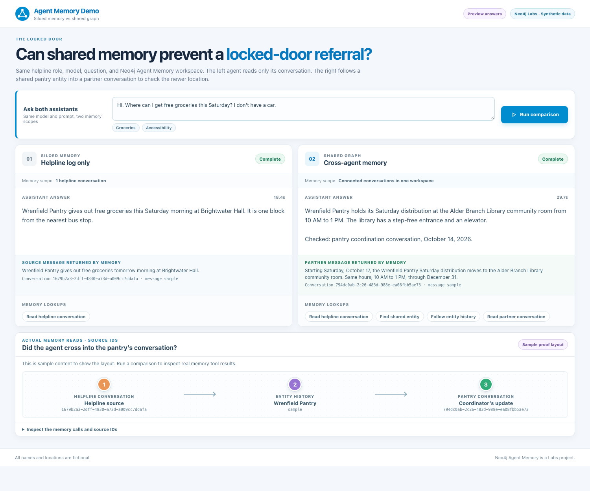

# The Locked Door: browser demo

Run `./browser-ui/go.sh`, then ask both assistants the same question in the
page that opens. The two original `go.sh` agents still do the work; this page
shows their answers side by side. No frontend build or new package is needed.

The proof area uses the actual MCP tool responses from each run. It shows the
source messages and observed calls, and marks the Wrenfield Pantry crossing as
verified only when one entity history contains both conversation IDs and the
agent reads the pantry assistant's conversation. Both agents use the same
Neo4j Agent Memory workspace; their retrieval scopes differ.

For a quick look at the completed layout, open `http://127.0.0.1:8787/?preview=1`.
That mode is labeled as sample data and does not call the agents.

The server listens only on `127.0.0.1` and serves the small `static` folder.
The Agent Memory credential stays in the existing local MCP setup.
